<!-- NxtWave AI Project Passport (AIPP) README -->
<div align="center">

  

  <h1>NxtWave AI Project Passport</h1>

  <p>
    <strong>A Full-Stack Student Growth & Workshop Registration Platform</strong>
  </p>

  <p>
    <a href="https://nxtwave-ai-project.vercel.app/">
      
    </a>
    
    
    
    
  </p>

</div>

---

## 📌 Overview

**NxtWave AI Project Passport (AIPP)** is a student-focused web application designed for the growth campaign **"Build Your First AI Project in 60 Minutes."**

The project demonstrates how a well-designed website, student referrals, project recommendations, and campaign analytics can support a low-budget workshop registration campaign.

The campaign plan targets **500 registrations in 7 days with a maximum budget of ₹2,000**. These are campaign goals, not claims of registrations already achieved.

## 🎯 Campaign Goals

| Item | Description |
|---|---|
| Target audience | Final-year engineering students |
| Workshop | Build Your First AI Project in 60 Minutes |
| Workshop format | Free online workshop |
| Registration target | 500 students |
| Campaign duration | 7 days |
| Total planned budget | ₹2,000 |
| Target cost per registration | ₹4, if 500 registrations are achieved within the budget |

## ✨ Key Features

### 🏠 1. Workshop Landing Page
- Clear workshop introduction and call-to-action buttons.
- Dark visual theme with cyan highlights and pink accents.
- Responsive navigation and mobile-friendly layout.
- Referral source capture from URL parameters.

### 🔎 2. AI Project Finder
- Interactive, three-question project discovery experience.
- Considers student interests, skill level, and learning goals.
- Provides a relevant starter-project recommendation.
- Displays progress through the selection process.

### 🎓 3. Personalized Project Passport
Students can explore starter projects such as:

- Resume Feedback Assistant
- Student Expense Analyzer
- Study Notes Summarizer
- Campus FAQ Assistant

Each recommendation includes a project explanation and practical starter tasks. Recommendations use predefined matching logic rather than claiming to be generated by an AI model.

### 📝 4. Student Registration
- Registration form for essential student information.
- Graduation-year and input validation.
- Referral-code capture.
- Duplicate-registration prevention when supported by the configured backend.

### 🤝 5. Student Referral Center
- Referral-code and invite-link sharing.
- WhatsApp sharing support.
- Referral attribution through URL parameters.
- Tools designed to encourage student-to-student outreach.

### 🏆 6. Campus Leaderboard
- Campus participation and referral rankings.
- Search and filtering features where implemented.
- Demo-data labels to distinguish sample rankings from verified campaign results.

### 📊 7. Growth Hub
- Campaign target and progress overview.
- Planned budget allocation.
- Channel-wise registration targets.
- Seven-day execution roadmap.
- Clear distinction between demonstration data and live campaign data.

### 🔐 8. Organizer Dashboard
- Campaign metrics and registration management, depending on backend configuration.
- Budget and source breakdowns.
- Registration export functionality where enabled.
- Supabase authentication and database security support.

## 🛠️ Tech Stack

<div align="center">

  <h3>Frontend</h3>

  
  
  
  
  

  <h3>Backend & Database</h3>

  
  
  

  <h3>Tools & Quality</h3>

  
  
  
  

</div>

| Technology | Purpose |
|---|---|
| React 19 | Component-based user interface |
| TypeScript | Type safety and maintainable application code |
| Vite | Development server and production build |
| Tailwind CSS | Responsive styling and interface design |
| React Router | Page navigation |
| Supabase | Authentication, PostgreSQL integration, and backend services |
| PostgreSQL | Structured storage for registrations and campaign data |
| Deno Edge Functions | Optional server-side registration processing |
| Node.js and npm | Development tooling, package management, and testing |
| Vercel | Website deployment |
| Git and GitHub | Version control and source-code hosting |

## 🏗️ Application Architecture

```text
NxtWave AI Project Passport
│
├── Frontend
│   ├── Workshop Landing Page
│   ├── Project Finder
│   ├── Project Passport
│   ├── Registration
│   ├── Referral Center
│   ├── Campus Leaderboard
│   ├── Growth Hub
│   └── Organizer Dashboard
│
├── Shared Application Logic
│   ├── Project Recommendation Engine
│   ├── Input Validation
│   ├── Referral Attribution
│   ├── Campaign Analytics
│   └── Service Layer
│
├── Backend (when configured)
│   ├── Supabase Authentication
│   ├── PostgreSQL Database
│   ├── Row-Level Security
│   └── Registration Edge Function
│
└── Deployment
    ├── GitHub Repository
    └── Vercel Hosting
```

## 🚀 Getting Started

### Prerequisites

- Node.js 20 or later
- npm
- Git

### 1. Clone the repository

```bash
git clone https://github.com/saikiranboya955/NXT-WAVE-AI-PROJECT.git
cd NXT-WAVE-AI-PROJECT
```

### 2. Install dependencies

```bash
npm install
```

### 3. Start the development server

```bash
npm run dev
```

Open the local URL printed in your terminal, usually:

`http://localhost:5173`

### 4. Run tests

```bash
npm test
```

### 5. Run lint checks

```bash
npm run lint
```

### 6. Create a production build

```bash
npm run build
```

## 🔑 Environment Configuration

For a live Supabase connection, configure the environment variables required by the application's Supabase client and deployment setup.

Example:

```env
VITE_SUPABASE_URL=https://your-project-id.supabase.co
VITE_SUPABASE_PUBLISHABLE_KEY=your-public-publishable-key
```

Use the exact variable names expected by the current project code. If the project uses `VITE_SUPABASE_ANON_KEY` instead, follow the existing configuration.

**Security notes:**
- Never commit `.env` files or private service-role keys.
- Browser-exposed `VITE_` variables are public and must not contain secrets.
- Enable Row-Level Security and validate registration data on the server.
- Keep admin access restricted to authorized users.

If Supabase is not configured, the application may use demonstration data or browser-session storage, depending on the implemented service layer. A successful local build does not by itself confirm that live registration storage is working.

## 💰 Growth Campaign Plan

| Channel | Registration Target |
|---|---:|
| College clubs and placement cells | 180 |
| WhatsApp and Telegram communities | 120 |
| Student ambassadors and referrals | 100 |
| LinkedIn and Instagram | 60 |
| Permission-based email and personal outreach | 40 |
| **Total** | **500** |

### Planned Budget

| Expense | Allocation |
|---|---:|
| Ambassador incentives | ₹800 |
| Referral rewards | ₹500 |
| Creative assets and campus promotion | ₹400 |
| Contingency | ₹300 |
| **Total** | **₹2,000** |

These figures represent the proposed campaign strategy. Actual registrations, expenditure, and channel performance should be recorded and verified during execution.

## 🧪 Testing & Quality

The project includes tests for application logic such as:

- Project recommendation mapping.
- Registration input validation.
- Referral-code handling.
- Campaign budget calculations.
- Analytics and database security rules.

Run the current test suite with:

```bash
npm test
```

Use the actual terminal output as the source of truth for test counts and results.

## 🔒 Privacy & Transparency

- Collect only the information needed for workshop registration.
- Avoid exposing student emails or other personal information in public dashboards.
- Use appropriate access controls for organizer-only functionality.
- Label mock data and simulated metrics clearly.
- Do not present campaign targets as achieved results.
- Do not promise workshop certificates, placements, or other outcomes unless they are officially confirmed.

## 🌐 Live Links

- **Website:** https://nxtwave-ai-project.vercel.app/
- **GitHub Repository:** https://github.com/saikiranboya955/NXT-WAVE-AI-PROJECT

## 🔮 Future Improvements

- Add reliable end-to-end registration analytics.
- Improve referral attribution and duplicate/fraud detection.
- Test the registration journey with real students.
- Add accessibility and mobile usability checks.
- Compare channel conversion rates and optimize the campaign budget.
- Connect the organizer dashboard to verified live metrics.

## 👨‍💻 Project Information

**Project:** NxtWave AI Project Passport (AIPP)  
**Purpose:** Student acquisition and workshop growth campaign  
**Developer:** Sai Kiran Boya  
**Deployment:** Vercel  
**Repository:** GitHub

---

<div align="center">

  <p><strong>Build. Learn. Share. Grow.</strong></p>
  <p>Created for the NxtWave Growth Challenge.</p>

</div>
